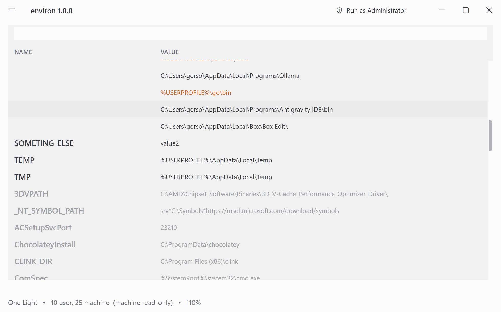
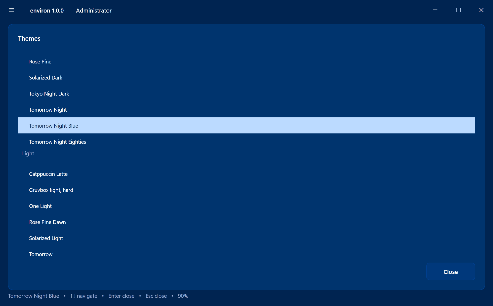
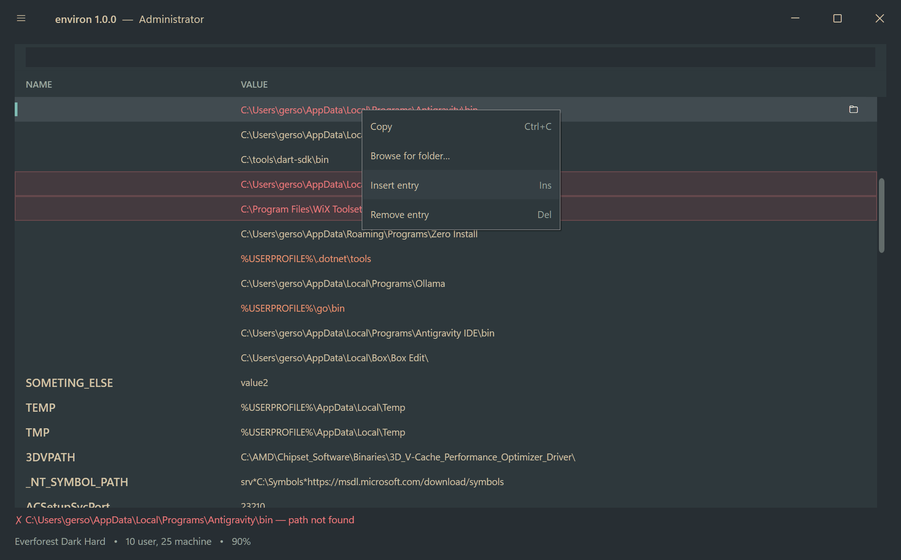

# Environ

> *L'éditeur des variables d'environnement. For English speakers, mostly.*

A modern environment-variable editor for Windows 11 — the one Microsoft forgot to ship.

**License:** MIT

---

## Why this exists

You know the dialog. Two nested pop-ups deep, a list box four lines tall, and `PATH`
crammed into a single text field as a 4,000-character semicolon casserole. It has not
meaningfully changed since Windows 95 wore short trousers.

Environ replaces it. Spiritual successor to RapidEE, reimagined for 2026: everything the
built-in dialog does, done properly, in a fast native Windows 11 app that looks like it
belongs on the operating system it runs on.

## Features

- **One grid, every variable.** Your variables (per-user), the machine's, **and** the ones
  that exist only in the running process — all in one editable, Excel-style grid. A per-row
  icon shows each one's origin at a glance: 👤 user, 🖥 machine, 🔒 session, ▶ inherited
  (the last two are read-only, in their own colors). Edit names and values in place.
  New variables are created deliberately: right-click gives you **New user variable** and
  **New machine variable** separately, the latter greyed out until you're running as admin.
- **Sort it your way.** Click the **Name** or **Value** header to sort the whole list
  alphabetically (click again to reverse) — scopes merge into one A–Z list, the icons keep
  them straight.
- **`PATH`, finally legible.** Path-style variables are split into **one row per entry** —
  add, remove, and reorder them with the keyboard (`Insert`, `Delete`, `Alt+↑/↓`). No more
  surgery on a semicolon soup.
- **It tells you what's wrong.** Folders that don't exist are flagged in **red**; duplicate
  entries are called out. `%VARIABLES%` are expanded so you see where things *actually* point.
  And if Windows is quietly overriding a variable you set, environ says so — *"not in effect"* —
  instead of letting you edit into the void.
- **Browse, don't type — or just open it.** Pick a folder or file from a dialog instead of
  pasting a path, and it's polite about it: if your value was `%USERPROFILE%\go`, picking a
  subfolder keeps the `%USERPROFILE%` prefix instead of flattening it to `C:\Users\you\...`.
  Any path value — even a read-only one — can be **opened or revealed in Explorer** straight
  from the grid.
- **It knows things.** Built-in descriptions for ~90 common variables (`JAVA_HOME`,
  `GOPATH`, `TEMP`, …) appear in the detail strip, and read-only variables explain *why* they
  can't be edited here. It also learns which variables point at folders or files so the right
  browse/reveal affordance shows up — even for the ones it's never heard of.
- **Nothing happens until you say so.** Edits are staged. A **dry-run review** shows exactly
  what will change before a single byte hits the registry — and it notices if something
  changed underneath you in the meantime.
- **An undo button for your entire environment.** Every save is snapshotted to a local
  history. Browse it, diff any two states, and **restore** — because "what did I do to PATH
  last Tuesday?" deserves an answer.
- **Search.** Type to filter. That's it. That's the feature.
- **Take it with you.** Export your whole environment to a TOML file and import it on another
  machine (or after the inevitable reinstall).

## Themes

Twenty built-in Base16 color schemes — Catppuccin, Gruvbox, Nord, Solarized, Tokyo Night,
the Tomorrow family (including the gloriously blue *Tomorrow Night Blue*) and friends —
grouped by light and dark, switched live. Fancy something else? Drop any Base16 `.yaml`
into the `themes` folder and it shows up. Zoom (`Ctrl`+mouse-wheel) and horizontal scrolling
for the truly cursed `PATH` are adjustable too.

**Font** picks the UI text family from everything installed on the machine. Like the theme
picker it previews live — the whole window, list included, redraws in the candidate font as
you arrow through it, so you judge the font by the app rather than by a sample box. `A`–`Z`
jumps to a family, `Enter` keeps it, `Esc` puts back what you had.

## Session vs. inherited variables

Not everything in your environment lives in the registry. Environ shows those extras too,
read-only, and splits them into two kinds because they behave differently:

- 🔒 **session** — Windows built these at sign-in: `USERPROFILE`, `LOCALAPPDATA`, `USERNAME`,
  `ProgramFiles`. Every process on your machine sees them. They're read-only here because
  changing them isn't an environment-variable edit — it's relocating a system folder.
- ▶ **inherited** — the process that *launched* environ set these. A `POSH_*` from your
  prompt theme, `VisualStudioVersion` from a developer command prompt, `VIRTUAL_ENV` from an
  activated venv, `WT_SESSION` from Windows Terminal. They exist in that process tree only.

This is why **inherited variables disappear when you click "Run as Administrator"**. Elevation
doesn't fork environ; it asks Windows to start a *new* process, whose parent is a system
service rather than your shell. That process genuinely has no `POSH_CURSOR_LINE`. Environ
shows you what's actually there rather than replaying a stale snapshot at you — the empty
space is the honest answer.

## Machine variables & "Run as Administrator"

Environ starts **unelevated**, so your own variables are fully editable while the machine's
stay safely read-only. Need to touch a system variable? One click on **Run as Administrator**
relaunches with a UAC prompt — and the title bar grows a tasteful "— Administrator" so you
remember you're playing with the big-kid settings.

## Install

Grab the installer from the [Releases](https://github.com/gersonkurz/environ/releases) page.
It's a single bootstrapper that picks the right build for your machine (**x64 or ARM64**),
optionally adds environ to your `PATH`, and offers to launch it when it's done.

No .NET, no Electron, no runtime to chase down — just one small native executable that's
open before you've finished letting go of the mouse button.

## License

MIT. Do what you like; don't blame us if you set `PATH` to something silly.
