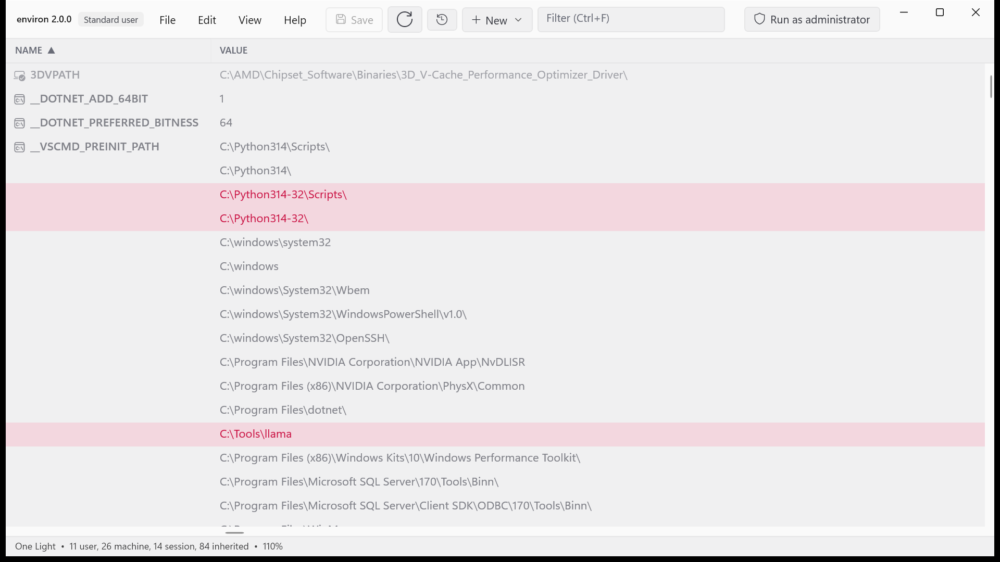
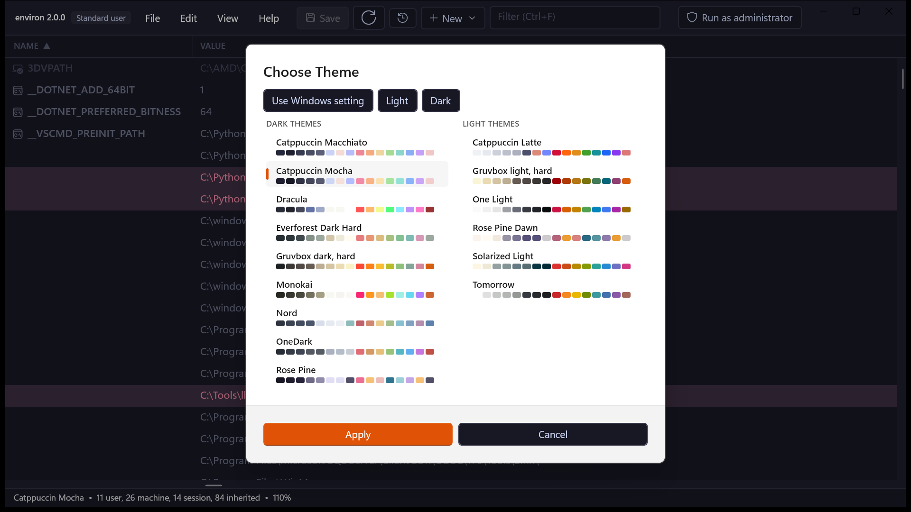

# Environ

> *L'éditeur des variables d'environnement. For English speakers, mostly.*

A modern environment-variable editor for Windows 11 — built with native C++20 and WinUI 3.

**Manual:** [gersonkurz.github.io/environ](https://gersonkurz.github.io/environ/) · **License:** MIT

---

## Why this exists

You know the dialog. Two nested pop-ups deep, a list box four lines tall, and `PATH`
crammed into a single text field as a 4,000-character semicolon casserole. It has not
meaningfully changed since Windows 95 wore short trousers.

Environ replaces it. Spiritual successor to RapidEE, reimagined for Windows 11: everything
the built-in dialog does, done properly, in a native WinUI 3 desktop app with a single-row
title bar, Mica backdrop, keyboard-first Excel-style editing, and zero external runtimes to
install.

## Features

- **One grid, every variable.** Your variables (per-user), the machine's, **and** the ones
  that exist only in the running process — all in one editable, virtualized grid. A per-row
  icon shows each one's origin at a glance: 👤 user, 🖥 machine, 🔒 session, ▶ inherited
  (the last two are read-only, in their own colors). Edit names and values in place with
  `F2`, double-click, and `Tab`/`Shift+Tab`.
- **Single-row Windows 11 chrome.** Title, role badge, menu bar (`File`, `Edit`, `View`,
  `Help`), `Save`, `Refresh`, `History`, `+ New`, live `Filter (Ctrl+F)`, and
  `Run as administrator` all live in one compact title bar row — leaving the entire window
  body to your variables.
- **`PATH`, finally legible.** Path-style variables are split into **one row per entry** —
  add, remove, and reorder them with the keyboard (`Ins`, `Del`, `Alt+↑/↓`). Long values
  scroll horizontally under a **frozen, resizable `NAME` column** (`Shift+Wheel` or the
  bottom scrollbar).
- **Native tooltips & live diagnostics.** Folders that don't exist are flagged in **red**;
  duplicate entries are called out. Hover any row for a native Windows tooltip showing the
  expanded `%VARIABLE%` path, missing/duplicate/shadowed warnings (*"not in effect"*),
  built-in descriptions for ~90 common variables, and read-only explanations.
- **Browse, don't type — or just open it.** Pick a folder or file from the in-cell browse
  button without losing `%USERPROFILE%`-style prefixes, or reveal any path (even read-only
  ones) directly in Explorer.
- **Nothing happens until you say so.** Edits are staged. Press `Ctrl+S` for a **dry-run
  review dialog** showing every add, modify, rename, and delete before a single byte hits
  the registry — with concurrent external-change detection.
- **An undo button for your entire environment.** Every save automatically snapshots your
  environment to a local SQLite history. Press `Ctrl+H` to diff any snapshot against the
  current registry and **restore** it as staged edits.
- **Take it with you.** Export your environment to round-trippable TOML (`File → Export
  TOML...`) and import/merge it on another machine (`File → Import TOML...`).

## Themes & Fonts

Open **`View → Theme...`** to pick `Use Windows setting`, `Light`, `Dark`, or any of twenty
built-in **Base16** color schemes (Catppuccin, Dracula, Everforest, Gruvbox, Monokai, Nord,
One Light/Dark, Rosé Pine, Solarized, Tokyo Night, Tomorrow, and more) in a compact dialog
that **live-previews directly on the grid behind it**. Drop any Base16 `.yaml` into the
`themes` folder and it appears automatically.

Open **`View → Font...`** to pick any installed Windows font family with live preview and
`A`–`Z` type-to-jump. Zoom the grid with `Ctrl+MouseWheel` or `Ctrl++` / `Ctrl+-` / `Ctrl+0`.

## Machine variables & "Run as administrator"

Environ starts **unelevated**, so your user variables are immediately editable while machine
variables remain safely read-only. Click **Run as administrator** in the title bar to
relaunch elevated (with an unsaved-changes guard) — the title bar badge switches to
`Administrator` and machine variables unlock.

## Install

Download the installer from the [Releases](https://github.com/gersonkurz/environ/releases)
page. It's a single self-contained bootstrapper that installs the right native build for
your machine (**x64 or ARM64**), bundles its own Windows App SDK and VC runtime, optionally
adds `environ` to `PATH`, and offers to launch it when finished.

See the [User Manual](https://gersonkurz.github.io/environ/) for the full guide and keyboard
reference.

## License

MIT. Do what you like; don't blame us if you set `PATH` to something silly.
