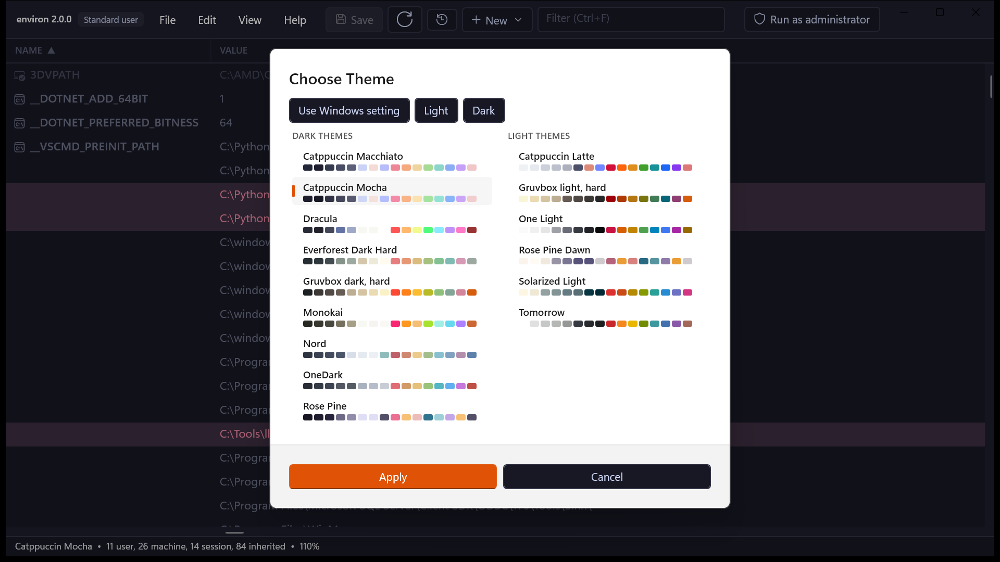
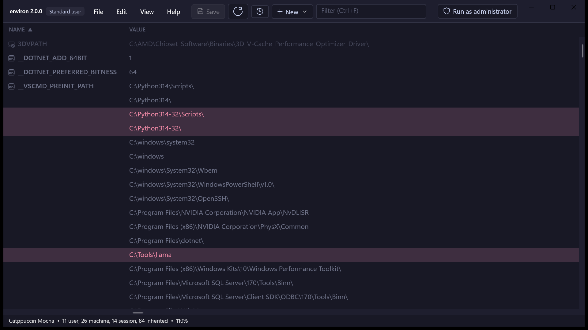
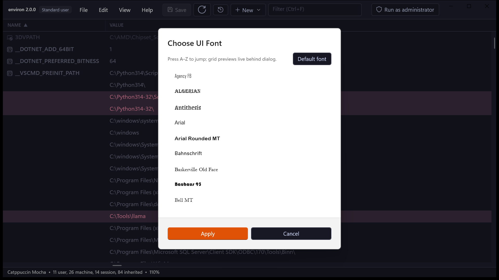

# Themes, fonts, and zoom

[← Back to contents](index.md)

## Live-preview Theme dialog

Choose **`View → Theme...`** to open the **Choose Theme** dialog right over the live grid.

- **Windows / built-in modes**: click **Use Windows setting** (honors Windows Light/Dark
  and High Contrast), **Light**, or **Dark**.
- **20 built-in Base16 schemes**: grouped into **Dark Themes** and **Light Themes**, each
  shown with its 16-color palette swatch (`base00`–`base0F`). Clicking or arrowing through
  themes live-previews the entire window behind the dialog.
- Click **Apply** to persist the theme to `%LOCALAPPDATA%\environ\environ.toml`, or
  **Cancel** / `Esc` to revert.

### Adding custom Base16 themes

Drop any standard Base16 `.yaml` file into the `themes/` folder beside `environ.exe` and
relaunch — Environ loads it automatically and classifies it as Dark or Light based on
background luminance.

## Live-preview Font dialog

Choose **`View → Font...`** to pick any installed Windows font family via DirectWrite.

- Every family is rendered in its own typeface, and the grid behind the dialog updates live
  as you browse.
- Press **`A`–`Z`** to jump directly to font families starting with that letter (press
  again to cycle through matches).
- Click **Default font** to reset to `Segoe UI Variable Text`.

## Zoom and horizontal scrolling

- **Zoom**: hold `Ctrl` and scroll the mouse wheel, or press **`Ctrl++`**, **`Ctrl+-`**,
  and **`Ctrl+0`** (50%–200%). Zoom scales real font sizes and row heights — never blurry
  bitmap scaling — and persists across launches.
- **Frozen `NAME` column & value-only horizontal scroll**: long `PATH` entries scroll
  smoothly under the `VALUE` column via **`Shift+MouseWheel`** or the bottom horizontal
  scrollbar while the `NAME` column stays pinned on the left.
