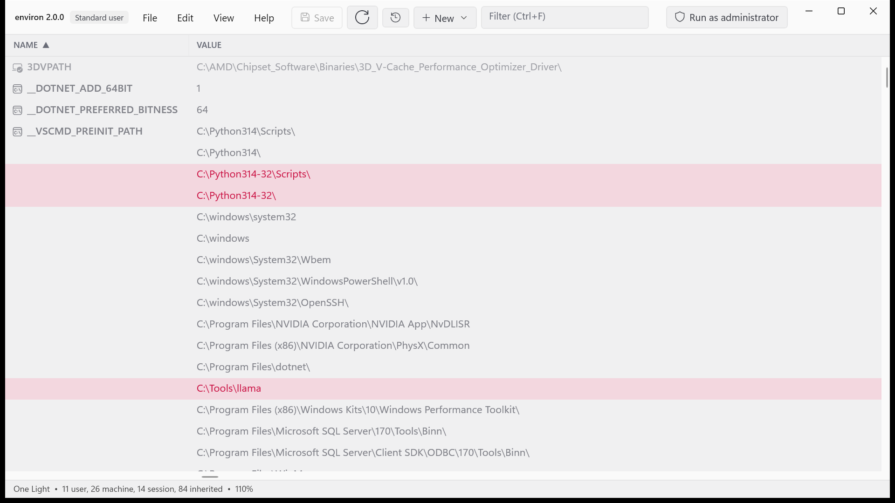

# Environ

Environ is a modern environment-variable editor for Windows 11. It puts your user variables,
machine variables, and live process variables in one fast, keyboard-driven grid — with
`PATH` entries expanded one per row, staged edits with dry-run review, automatic SQLite
snapshots, and live-preview Base16 themes.

## Contents

- [Getting started](getting-started.md) — installation, the single-row title bar, and elevation
- [Viewing and editing](editing.md) — inline editing, path lists, tooltips, browsing, and filtering
- [Saving, history, and TOML](saving-and-history.md) — dry-run review, snapshots, restore, and export/import
- [Themes, fonts, and zoom](appearance.md) — live-preview dialogs, Base16 YAML schemes, and horizontal scrolling
- [Scopes and the knowledge base](scopes.md) — User, Machine, Session, Inherited, and `knowledge.toml`
- [Keyboard shortcuts](keyboard.md) — complete shortcut reference
