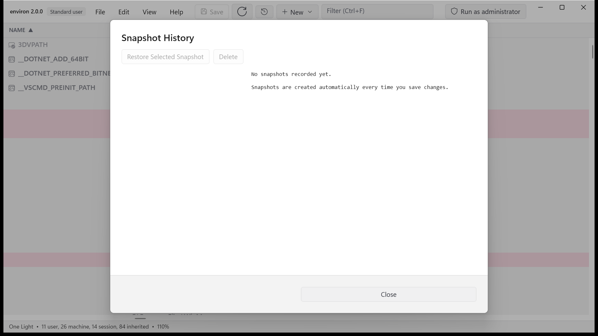

# Saving, history, and TOML

[← Back to contents](index.md)

## Staged edits and dry-run Save Review

Nothing is written to the Windows registry while you edit. Modified, renamed, and newly
added rows show a subtle dirty accent bar, and the **Save** button in the title bar turns
on with a dot (`Save ●`).

Press **`Ctrl+S`** (or click **Save**) to open the **Review Changes** dialog:

1. **Validation** checks every modified scope for blank variable names, `=` characters, or
   case-insensitive duplicate names before anything is written.
2. **Dry-run diff** lists every pending `[User]` and `[Machine]` Add, Modify, Rename, and
   Delete, color-coded by kind.
3. **Concurrent change check** re-reads the live registry right before writing; if another
   installer or tool modified your environment while Environ was open, you are warned before
   overwriting.
4. **Automatic snapshot** records the pre-save registry state to SQLite so every save is
   reversible.
5. **Broadcast** sends `WM_SETTINGCHANGE` (`"Environment"`) so Explorer and newly launched
   terminals pick up the updated environment immediately.

## Snapshot history (`Ctrl+H`)

Press **`Ctrl+H`** (or click the **History** button in the title bar) to open the
**Snapshot History** dialog.

- Snapshots are stored locally in `%LOCALAPPDATA%\environ\environ.db` (automatically pruned
  after 90 days, capped at 500 entries).
- Selecting any snapshot displays a monospace diff comparing that snapshot against your
  current registry state, including reordered `PATH` segments.
- Click **Restore Selected Snapshot** to stage the snapshot's values back into the main
  grid as dirty edits — review them and press `Ctrl+S` when ready.
- Click **Delete** to remove an individual snapshot.

## Exporting and importing TOML

- **`File → Export TOML...`** writes your current User and Machine variables to a clean,
  round-trippable TOML file (preserving `REG_EXPAND_SZ` expandability flags).
- **`File → Import TOML...`** parses a TOML export and merges it onto your current
  variables as **staged dirty edits**, so you can inspect every change in the grid and in
  Save Review before committing to the registry.
